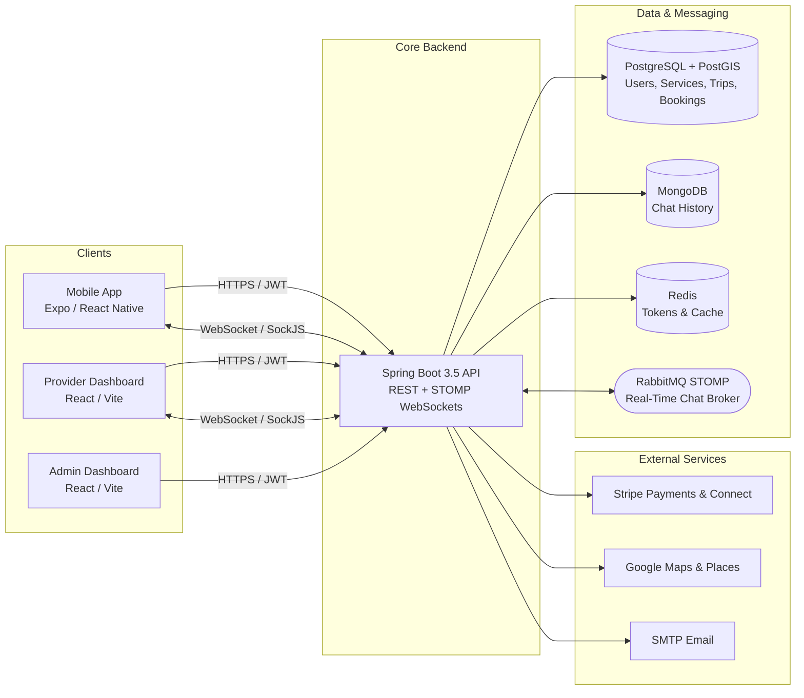

# LankaTrails

**A full-stack Sri Lankan tourism platform connecting travelers, local service providers, and platform administrators across mobile and web.**

LankaTrails brings end-to-end trip planning, multi-vertical service booking, collaborative budgeting, real-time messaging, and provider verification into a unified ecosystem built with Spring Boot, React, and React Native (Expo).

---

## Repositories

| Repository | Stack | Responsibility |
| :--- | :--- | :--- |
| **[lankatrails-backend](https://github.com/LankaTrails/lankatrails-backend)** | Java 21, Spring Boot 3.5, PostgreSQL/PostGIS, MongoDB, Redis, RabbitMQ, Stripe | Core REST API, geospatial search, JWT auth, Stripe payments & webhooks, real-time STOMP WebSocket relay, and email notifications |
| **[lankatrails-mobile-app](https://github.com/LankaTrails/lankatrails-mobile-app)** | React Native, Expo Router, TypeScript, NativeWind, Redux Toolkit, Stripe | Tourist-facing mobile app for trip planning, service discovery, booking & checkout, expense splitting, and live chat |
| **[lankatrails-provider-dashboard](https://github.com/LankaTrails/lankatrails-provider-dashboard)** | React, TypeScript, Vite, Tailwind CSS, shadcn/ui, Redux Toolkit, STOMP | Service provider web portal for managing listings, policies, licenses, bookings, reviews, and tourist messages |
| **[lankatrails-admin-dashboard](https://github.com/LankaTrails/lankatrails-admin-dashboard)** | React, TypeScript, Vite, Tailwind CSS, shadcn/ui, Recharts | Platform administration dashboard for provider verification, license checks, analytics, bookings oversight, and complaint resolution |

---

## System Architecture

---

## Key Features

### Tourist Mobile App
* **Trip Planning & Collaboration:** Create multi-day itineraries, invite fellow travelers via shareable deep links, and manage shared trip schedules on interactive maps.
* **Multi-Vertical Discovery & Booking:** Search nearby Sri Lankan services across five verticals—Accommodation, Transport, Activities, Tour Guides, and Food & Beverage—check real-time time slots, and pay via Stripe PaymentSheet.
* **Budget & Expense Tracking:** Set per-category trip budget limits, log shared expenses, and track individual cost splits.
* **Real-Time Communication & Support:** Message providers directly or chat in trip group rooms over WebSockets, bookmark favourites, leave verified reviews, and track support complaints.

### Service Provider Dashboard
* **Service & Policy Management:** Publish, edit, activate, or deactivate listings and custom cancellation/service policies across all five service categories.
* **Bookings & Calendar:** Track incoming platform and external bookings across calendar views and date ranges.
* **Verification & Messaging:** Submit business licenses for admin approval and communicate with tourists in real time with file attachments and typing indicators.

### Admin Dashboard
* **Provider & License Verification:** Review pending provider applications, inspect uploaded business licenses, and approve or manage provider accounts.
* **Platform Analytics:** Monitor tourist growth, booking volume, revenue trends, and top-performing services.
* **Complaint & Dispute Resolution:** Investigate tourist complaints, manage refund statuses, and dispatch automated email feedback to both tourists and providers.

---

## Tech Stack

* **Backend:** Java 21, Spring Boot 3.5, Spring Security (JWT), Spring Data JPA, Hibernate Spatial (PostGIS), Spring Data MongoDB, Spring Data Redis, Spring AMQP / WebSocket (STOMP), Thymeleaf
* **Web Frontends:** React, TypeScript, Vite, Tailwind CSS, shadcn/ui, Redux Toolkit, React Query, Recharts
* **Mobile:** React Native, Expo Router, TypeScript, NativeWind, Redux Persist, `@stripe/stripe-react-native`, `react-native-maps`
* **Infrastructure & Integrations:** PostgreSQL + PostGIS, MongoDB, Redis, RabbitMQ, Stripe API, Google Maps / Places / Directions APIs
<!-- 
---

## Team

> Each team member should add their GitHub profile and contributions via a Pull Request to `main`.

| Member | GitHub | Focus Area |
| :--- | :--- | :--- |
| Member 1 | `@username` | Backend / Mobile / Provider / Admin |
| Member 2 | `@username` | Backend / Mobile / Provider / Admin |
| Member 3 | `@username` | Backend / Mobile / Provider / Admin |
| Member 4 | `@username` | Backend / Mobile / Provider / Admin |

---

## Roadmap

* [ ] Finalize security hardening, API contract alignment, and environment cleanup across all four repositories
* [ ] Add unified `docker-compose.yml` and local setup guide (`docs/SETUP.md`) to this hub
* [ ] Deploy live web dashboards, backend API, and mobile preview build with seeded demo data
* [ ] Add UI screenshots and end-to-end walkthrough video

---

## License

This project is licensed under the terms of the repository's [LICENSE](https://www.google.com/search?q=./LICENSE). -->
